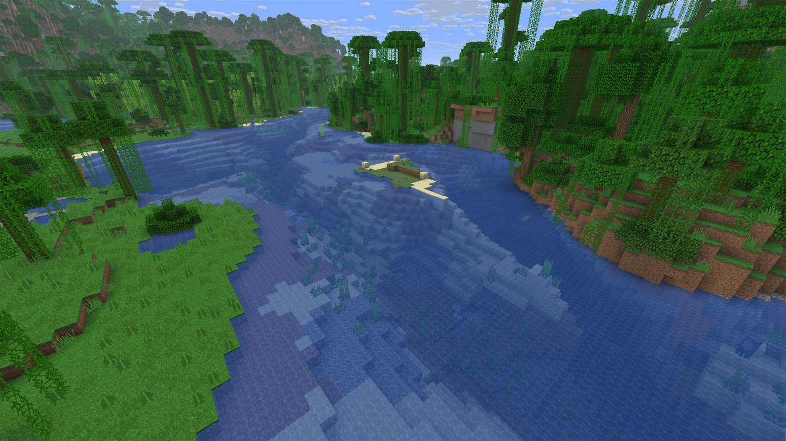
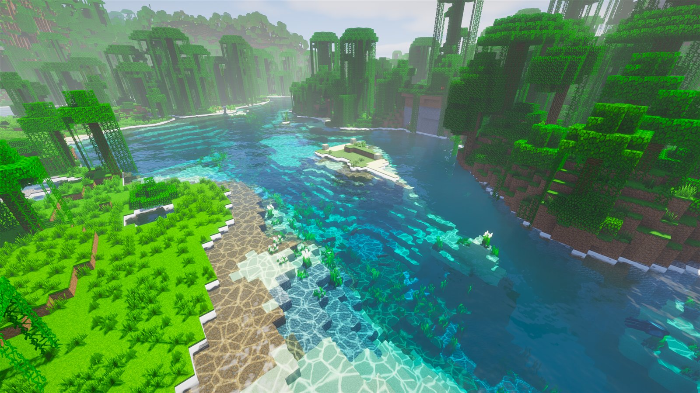
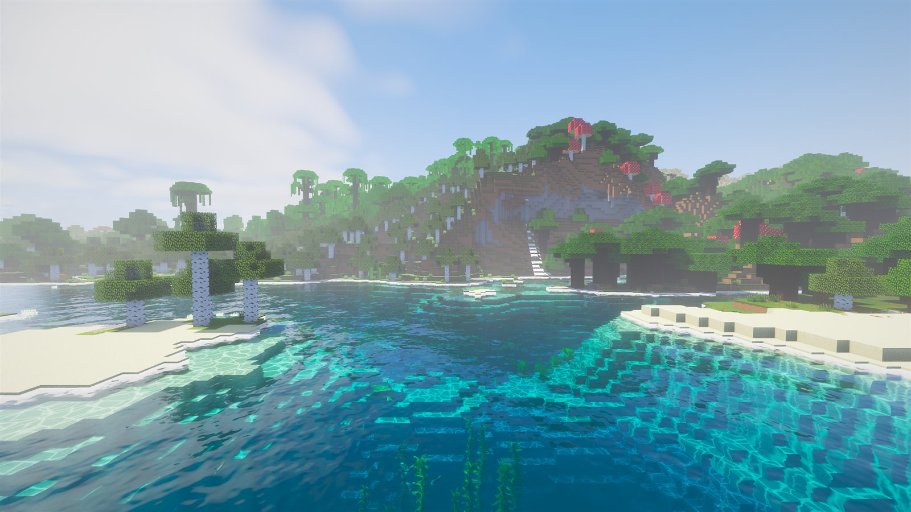
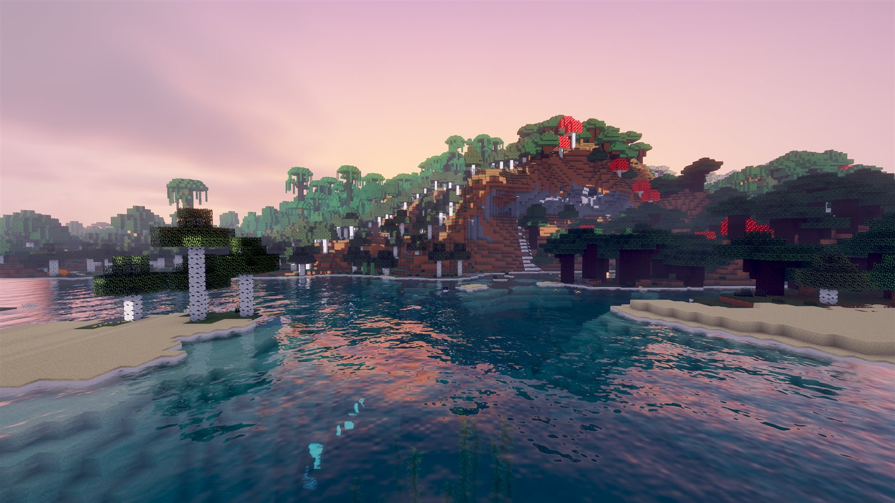
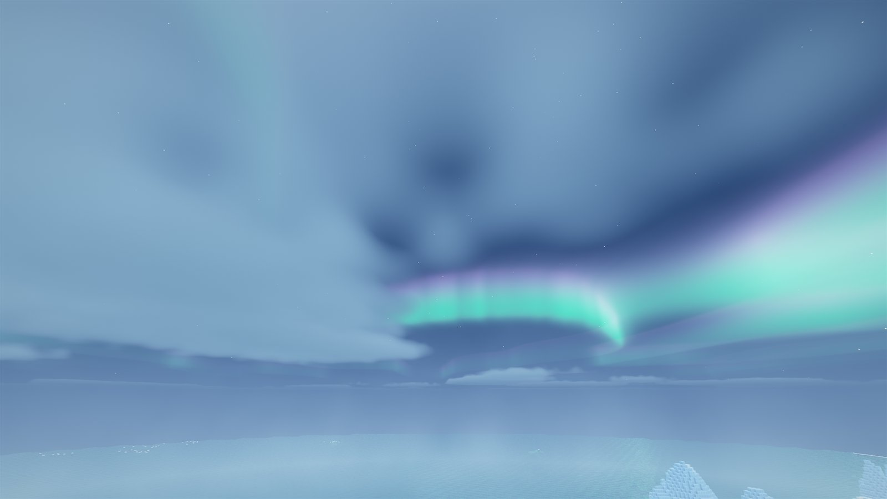
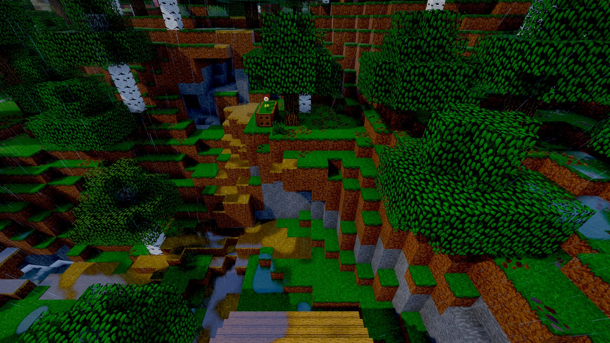
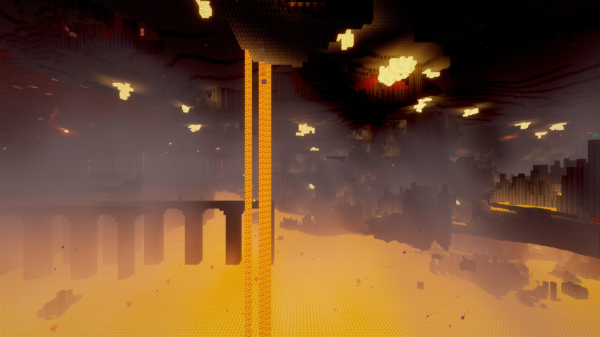
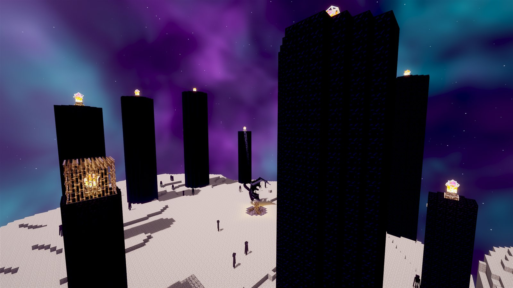
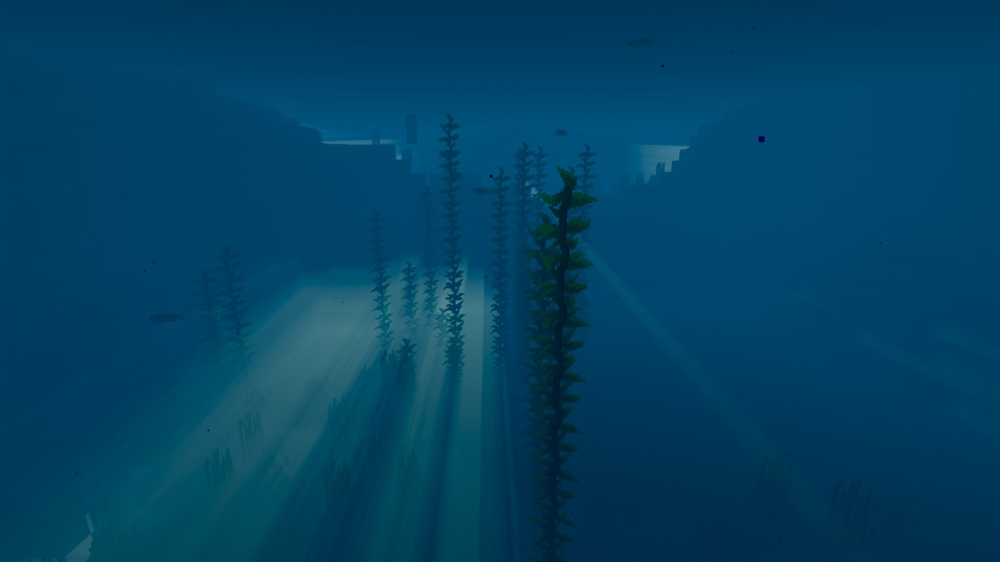
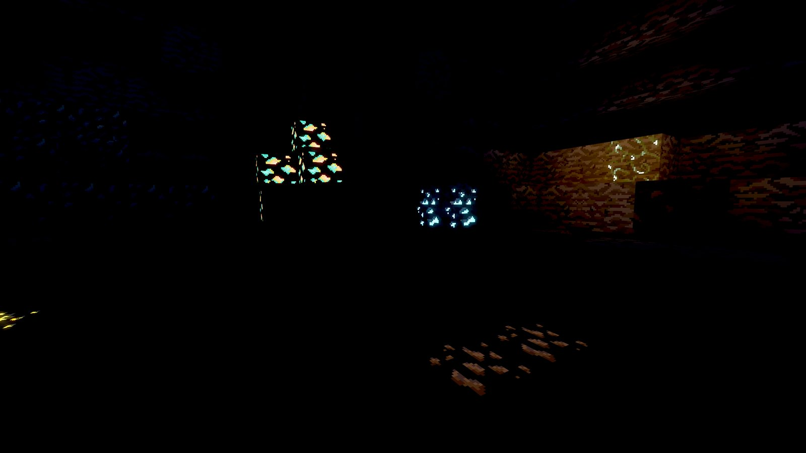

# Tengu Aurora

Vibrant, cinematic Minecraft shaders for **Iris**, by **TenguTerror**. The code was written with AI
(see [How it was made](#how-it-was-made)).

Clear tropical water, warm sunsets, volumetric clouds, northern lights over snowy biomes,
a smoky Nether lit by its lava sea, and an End that is a dark void under a living nebula.

**[Download the latest release](https://github.com/tenguterror/tengu-aurora/releases/latest)**

## Shaders off vs on

The same view of a jungle river at noon, a few seconds apart, with the shaders toggled off and on (Iris **K** key).

| Vanilla (shaders off) | Tengu Aurora (shaders on) |
|---|---|
|  |  |

## Screenshots

All taken in-game during the release test pass (2560×1440, Faithful 32x).

| | |
|---|---|
|  |  |
| **Water at noon** | **Late sunset** |
|  |  |
| **Aurora over ice spikes** | **Rain puddles** |
|  |  |
| **Nether lava sea and smoke plumes** | **The End under the nebula** |
|  |  |
| **Underwater light rays through kelp** | **A pitch-dark cave (glowing ores on)** |

---

## Install

1. Download `Tengu-Aurora-v2.1.0.zip` from the release page. Don't unzip it.
2. Drop it into `.minecraft/shaderpacks`.
3. In game: **Options → Video Settings → Shader Packs**, pick **Tengu-Aurora-v2.1.0**, press **Done**.

You need Minecraft Java with **Iris** (Fabric). Sodium is recommended.

---

## The setup it was built and tested on

Everything in this pack was tuned and checked in-game on this machine:

| | |
|---|---|
| CPU | AMD Ryzen 7 9800X3D (8 cores) |
| GPU | NVIDIA GeForce RTX 5080 (driver 617.14) |
| RAM | 32 GB |
| Display | 2560 × 1440, 144 Hz, fullscreen, V-Sync off, FPS cap 260 |
| Minecraft | Java 26.2 |
| Mods | Fabric Loader 0.19.3 · Iris 1.11.1 · Sodium 0.9.0 |
| Resource pack | Faithful 32x (CF32PA). The vanilla textures also work. |
| Game settings | Render distance 32 · simulation distance 32 · biome blend 7 |
| Shader profiles | All four benchmarked (see Performance) |

The test pass covered the overworld at noon, sunset, night with aurora, rain and underwater, plus
pitch-dark caves, the Nether lava sea and the End main island. Each scene was screenshotted and
reviewed, and anything that looked wrong was fixed and re-shot.

---

## Performance

### Measured on the dev rig

Ryzen 7 9800X3D + RTX 5080, 2560 × 1440, **render distance 32**, Faithful 32x, v2.1.0 (default
anti-aliasing: TAA + FXAA, CAS sharpening 40). Readings from the in-game F3 overlay, hovering over a
village with jungle and river in view. The active profile was confirmed in the Iris log before each
run. Two samples were taken per scene.

| Profile | Clear noon: FPS (p50 / p98) | Rainy sunset: FPS (p50 / p98) |
|---|---|---|
| Ultra | ~98 (96–98 / 58) | ~97 (93–96 / 56) |
| High (default) | ~119 (125–127 / 69–70) | ~111 (115–123 / 64–65) |
| Medium | ~125 (132–133 / 75–77) | ~121 (124–125 / 69–70) |
| Low | ~138 (154 / 85–86) | ~128 (138–139 / 75–76) |

The v2.1.0 anti-aliasing costs about 2–7% compared with v2.0.0 (Ultra ~100, High ~117, Medium ~134,
Low ~145 at clear noon). It's a fixed cost per frame, so it shows most on the lighter profiles.
Switching **FXAA Edge Smoothing** off or setting **Sharpening (CAS)** to 0 gets most of it back.

p50 is the median frame rate. p98 is the rate that 98% of frames beat, which is a good measure of
how smooth it feels. During the Ultra run the GPU sat at about 80% load (≈255 W), so render
distance 32 also puts real load on the CPU. A lower render distance will raise every number above.

### Projected for other setups

> **These are estimates, not benchmarks.** They are scaled from the measured numbers above by
> relative GPU speed and resolution, at render distance 16–24. Real results depend on your CPU,
> driver and render distance. If you measure your own setup, open an issue and it can be added
> as a measured row.

| Setup | Resolution | Suggested profile | Projected FPS |
|---|---|---|---|
| RTX 5080 / RTX 4080 class | 4K | High | 50 – 70 |
| RTX 4070 / RTX 3080 / RX 7800 XT | 1440p | High | 65 – 90 |
| RTX 4060 / RTX 3060 / RX 6600 | 1080p | Medium | 60 – 85 |
| GTX 1660 / RTX 2060 / RX 5600 XT | 1080p | Low | 35 – 55 |
| Integrated graphics / older laptops | 720p–1080p | Low, clouds off | 15 – 30 (not recommended) |

**What costs the most**, in order. Turn these down first if you need frames:

1. **Cloud Quality** (`CLOUD_STEPS`), or switch **Volumetric Clouds** off.
2. **Fog Quality** (`VL_STEPS`), or switch **Volumetric Fog & God Rays** off.
3. **Shadow Resolution** and **Shadow Distance**.
4. **Screen-Space Reflections** (water and puddles still get sky reflections without it).
5. Minecraft's own **render distance**, which is the biggest CPU-side cost.

The profiles set these for you:

| Profile | Shadows | Shadow distance | Fog steps | Cloud steps | SSR |
|---|---|---|---|---|---|
| Low | 2048 | 128 | 8 | 12 | off |
| Medium | 2048 | 160 | 12 | 16 | on |
| High | 3072 | 192 | 16 | 24 | on |
| Ultra | 4096 | 256 | 24 | 32 | on |

---

## What's in the pack, and why

The pack is a full **deferred renderer**. Minecraft's geometry is first written into G-buffers
(colour, normals, light levels, material IDs). The sky, lighting, water, fog and post-processing are
then computed as whole-screen passes. That makes one consistent lighting model possible across every
block, entity and dimension, instead of each object lighting itself.

### Passes (`shaders/program/`)

| Pass | What it does | Why |
|---|---|---|
| `shadow` | Renders the sun/moon shadow map with distortion. Coloured shadows through glass, caustics through water. | Sharp shadows near you, wide coverage far away, light that tints through glass and ripples under water. |
| `gbuffers_main` | Terrain, entities, hands, particles. Waving plants, material IDs, emissive detection, lava. | One shared program keeps every object consistent; material IDs let later passes treat water, lava and foliage differently. |
| `gbuffers_water` | Water, glass, ice, portals, slime. | Water is only marked here and fully composited later, so it can refract and reflect what's behind and around it. |
| `gbuffers_weather` | Rain and snow. | Thin, grey-white, wind-slanted streaks lit by the sky instead of vanilla's flat blue lines. |
| `gbuffers_discard` | Removes vanilla sky, sun, moon and clouds. | The pack draws its own sky so it can match the lighting exactly. |
| `deferred` | Sky, lighting of all opaque blocks, rain puddles, lava colour. | All lighting in one place: sun/moon, sky ambient, torches, ambient occlusion, subsurface glow through leaves. |
| `composite` (0) | Water body (refraction, absorption, foam, reflections), puddle reflections, underwater view. | Depth-based absorption is what makes shallow water clear turquoise and deep water dark blue. |
| `composite1` | Volumetric fog and god rays, Nether smoke, End haze. | Ray-marched through the shadow map so light shafts are actually blocked by trees and terrain. |
| `composite2` | Depth-aware blur of the fog, then applies it. | Lets the fog run at fewer steps without looking noisy or bleeding across edges. |
| `composite3` | FXAA edge smoothing, then temporal anti-aliasing (Catmull-Rom history, variance clipping). | FXAA keeps edges smooth even while moving, when TAA has to drop its history. TAA blends jittered frames for clean edges and cleans up noise from fog and soft shadows. |
| `composite4` | Bloom. | Gives bright things (sun, lava, glowstone) a soft glow. |
| `final` | Exposure, ACES tonemapping, colour grading, CAS sharpening, vignette. | Turns the HDR image into a filmic, vibrant final picture. Contrast Adaptive Sharpening (after AMD FidelityFX CAS) restores texture detail after TAA but backs off on high-contrast edges, so it doesn't bring the jaggies back. |

### Shared libraries (`shaders/lib/`)

| File | Contents |
|---|---|
| `settings.glsl` | Every option in the in-game menu, plus block material IDs. |
| `common.glsl` | Uniforms, noise, colour and space-conversion helpers. |
| `atmosphere.glsl` | Per-dimension sky, sun/moon/ambient colours, volumetric clouds, aurora, Nether and End skies. |
| `lighting.glsl` | Surface lighting used by both the deferred and the forward passes. |
| `shadow.glsl` | Shadow lookups with soft PCF filtering, coloured and caustic shadows. |
| `water.glsl` | Water waves, rain ripples, caustics. |
| `ssr.glsl` | Screen-space reflections. |
| `waving.glsl` | Wind animation for grass, leaves, vines and crops. |

### Design decisions

- **Water first.** The water look was the first thing locked in and is treated as untouchable:
  later changes were checked against it.
- **Readable nights.** Pure-black nights look realistic but are unplayable, so night ambient light
  is boosted with a cool blue tint. Clouds stay moonlit grey instead of glowing.
- **Caves stay dark anyway.** Underground there's no sky light, so the night boost doesn't apply and
  caves are pitch black without torches. Optional *Glowing Ores* lets ore veins glint.
- **Lava from its own texture.** A procedural crust pattern was tried and looked artificial. Instead
  the brightness of the lava texture itself is mapped onto a blackbody ramp (deep red → orange →
  yellow), so it animates naturally and works with any resource pack. It's calibrated to Faithful's
  lava and also fine with vanilla.
- **Nether smoke as plumes, not a wall.** Ash-grey smoke rises off the lava sea in separate
  swaying plumes, lit orange from below, so the Nether feels hot without hiding the terrain.
- **The End as a void.** Thin haze and a swirling purple and teal nebula with two star layers. A
  dense fog version was tried and rejected because it washed everything out.
- **Aurora only where it belongs.** Northern lights appear on clear nights in cold biomes (ice
  spikes, snowy plains, frozen peaks…) and sit behind the clouds. There's an *Aurora In All Biomes*
  option if you want them everywhere.
- **Rain you can see on the ground.** Puddles appear within seconds of rain starting, reflect the
  sky, and dry off slowly after it stops.
- **Restrained god rays.** Light shafts are capped so they never streak across the screen or blow
  out the image when looking toward a low sun or the sunlit sea floor.

---

## Settings

Shader Pack Settings has Low / Medium / High / Ultra profiles (High is the default) plus these menus:

- **Lighting & Shadows**: shadow resolution and distance, sun/ambient/torch brightness, glowing ores.
- **Foliage & Weather**: plant sway, lava motion, rain puddles and puddle amount.
- **Sky, Clouds & Fog**: fog and god rays, clouds, aurora brightness or "Aurora In All Biomes", Nether and End fog density.
- **Water**: wave height, caustics, reflections, shore foam.
- **Camera & Color**: TAA, FXAA edge smoothing, sharpening (CAS, 0–100), bloom, exposure, saturation, vibrance, contrast, vignette.

---

## How it was made

**This pack's code was written by AI.** All of the GLSL shader code, the build script and the
validation tool were written by **Claude** (Anthropic's AI model), working through Claude Code.
TenguTerror directed the project:

- set the visual goals and the reference look,
- played every build in-game and judged what looked right,
- rejected the attempts that didn't work (procedural lava crust, flow-streak foam, a foggy End),
- and signed off on the final release.

The development loop was:

1. Claude writes or changes the shaders.
2. Every program is compiled on the real GPU (`tools/validate.py`) to catch errors before Iris does.
3. The pack is built and loaded in game, and the Iris log is checked for errors.
4. For the final test pass, Claude drove the game itself through computer use (teleports, time and
   weather commands, in-game screenshots), reviewed every shot, and fixed what looked wrong. The
   performance numbers above were captured the same way.
5. TenguTerror decided what shipped.

Version history is in [CHANGELOG.md](CHANGELOG.md).

---

## Building from source

```
python tools/validate.py     # compile every program on your GPU (Windows, OpenGL)
python build.py              # writes dist/Tengu-Aurora-v<version>.zip
python build.py --install    # also copies it into .minecraft/shaderpacks
```

```
shaders/program/   one source file per pass
shaders/lib/       shared code
shaders/world*/    per-dimension entry stubs, generated by build.py
tools/validate.py  GPU compile check
```
